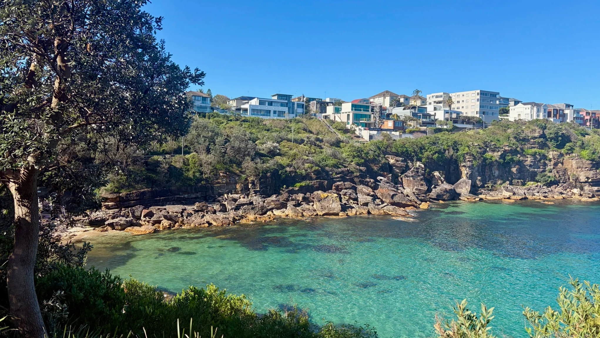
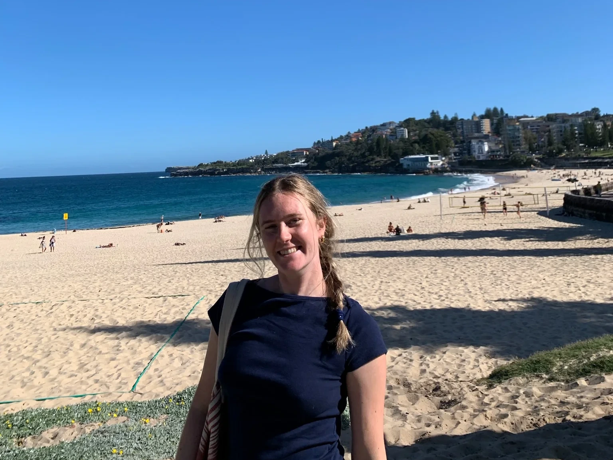
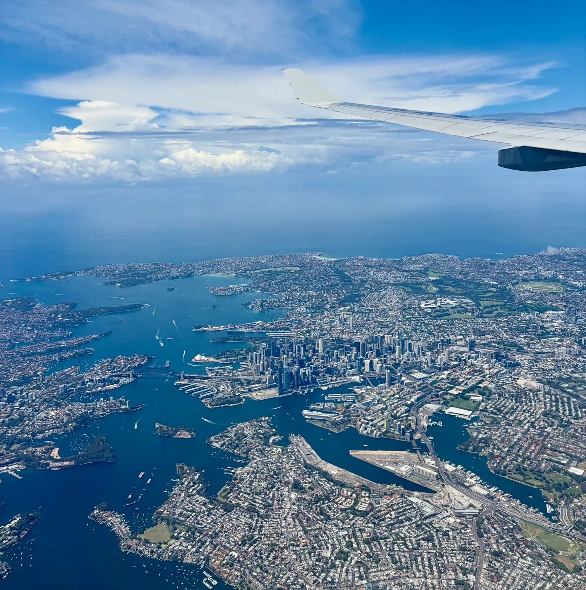

This week (Oct 19) we arrived in Sydney, Australia! We have been staying with Tahn’s family friend Bec who have welcomed us in and shown us the ropes of the city.

Sydney is a super vibrant, fun city with lots of young people! We have been getting around via public transportation while we find the neighborhood we want to live in which has been super easy. Except at the end of our very first bus ride the transportation officers checked everyone’s bus pass when they got off the bus. We were confident because we had old spare passes Bec lent us! However, turns out the ones we were using were only for kids under 15. We tried to tell him it was our very first bus ride on our very first day in Australia but he had no mercy and gave us a $400 fine. Bec says when the fine arrives she is going to return to sender and it will be no big deal but we shall see! Hopefully we don’t get in worse trouble for fee evasion…

Luckily the rest of our Sydney exploration is uphill from there and we spent our week exploring potential neighborhoods to live in. We saw Newtown, Dee Why, the CBD (Central Business District), Coogee, and Bondi. We had 6 tours of potential houses/apartments and some of them were definitely immediate nos. For example, we went to one where all of the roommates are members of the “ethical non-monogamy” group and warned us that sexual conversation sometimes occurs in common areas. 
We ultimately decided to go with Bondi Beach to have the iconic Sydney experience. Since we’ll be by the beach but are trying to keep things budget friendly, we’ll be living in a tiny apartment with one bathroom and five total people. Luckily it’s on a week to week basis so if it ends up being too tight to we can leave easily. We will be living with some other international people our age, who hopefully will become our first friends!

