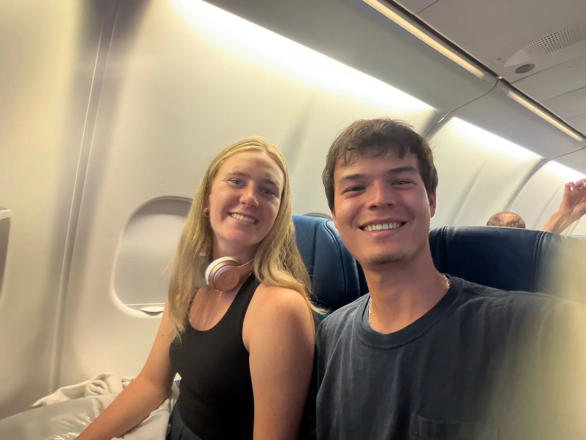
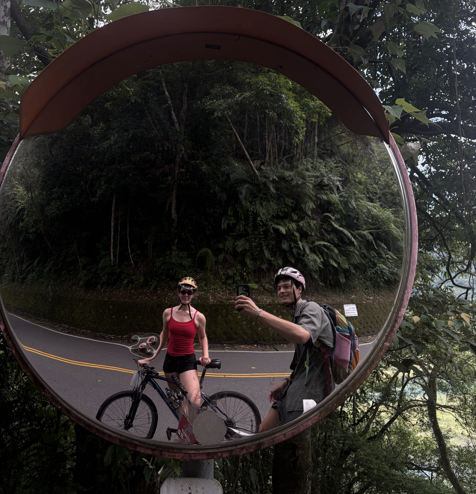
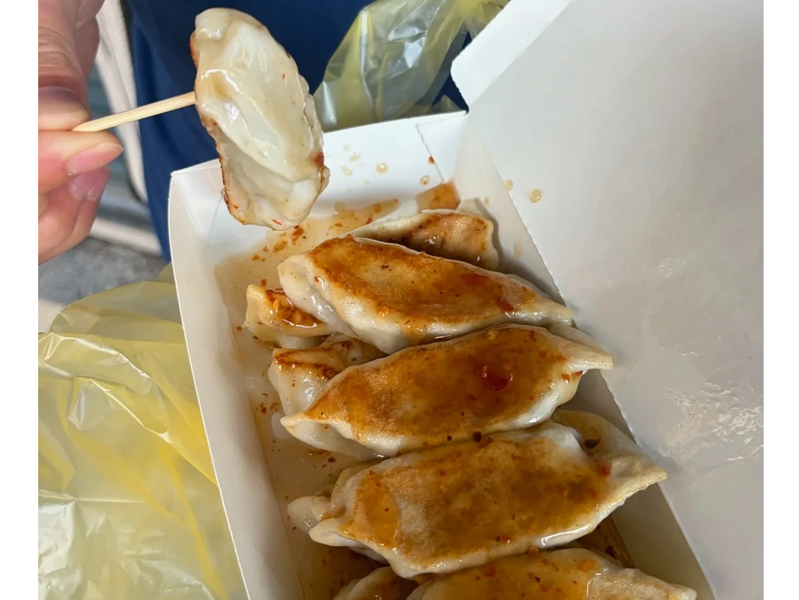
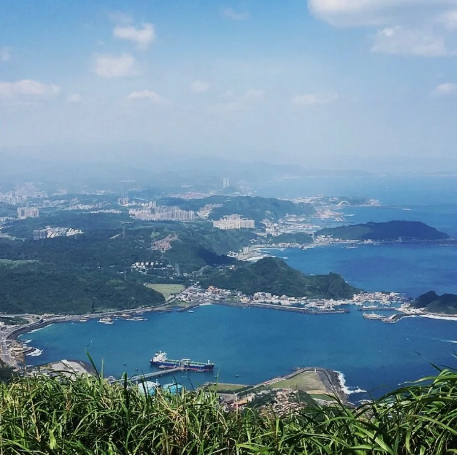
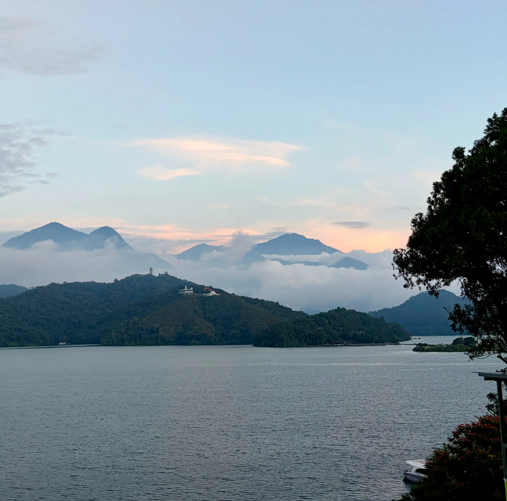

#### Travel Day  

We finally made to Asia! Our travel day was about 23 hours in total and flew Denver-Seattle, Seattle-Tokyo, and Tokyo-Taipei. Lots of yummy food along the way including pasta and mochi on the plane and ramen in the Tokyo airport.  We are excited for Taiwan and so far the Taiwanese people on our flight were already welcoming us and asking about our plans. 

#### Taiwan

*Two bikers* 

Taiwan has been great so far! We started off in Taipei with a couple of chill days trying to shake off the jet lag, but still usually going to bed by 8pm and waking up at 4:30am… There is lots of great food in Taipei and there are at least 5 vegetarian restaurants within a quarter mile of our AirBnB! Some of Tahn’s favorite foods have been the egg scallion pancake and noodle soup. Some of mine have been the kimchi hot pot and the hot and sour dumpling soup. Taiwan is also the founder of boba tea and there’s almost nowhere you can stand without seeing a shop, so we have been sure to get that everyday. Especially since coffee seems to be a bit of a delicacy and is pretty expensive here, although 7-11 had a pretty good oat milk latte! 

From Taiwan we took a day trip to Jiufen which is in the mountains near the coast and supposedly inspired the movie Spirted Away. They had a cool walking street with lots of snacks to try like taro balls, peanut ice cream rolls, and cream filled croissants. They’re especially known for their tea houses so we got an amazing pot of black lemon tea! We also hiked Mount Keelung, which was a lot of steep stairs that reminded us of the Manitou Incline! It was supposed to have great views of the ocean but when we got to the top it was so foggy we could hardly see each other (but I’ll attach a picture of what it was supposed to look like).

We spent the latter half of the trip in Sun Moon Lake and are so happy we did! We spent our time walking around town, sitting on our balcony which has a great view of the lake, and doing a bike ride around the lake. The bike ride was gorgeous and was actually ranked by CNN as one of the top 10 bike rides in the world. It was about 20 miles and more hilly than you’d think for a bike ride around a lake! My favorite part was all of the stops like the town of Ita Thao - home to the indigenous Thao people, our awesome tofu vegetable lunch place, various temples, and the Ci’en Pagoda. 

Overall we thought Taiwan was awesome! It was interesting to see how the Chinese and Japanese influences emerge while also having a uniquely Taiwanese culture. It’s also been interesting to learn about the geopolitical tensions with China and how many people in Taiwan do not affiliate as Chinese, just Taiwanese. Another cool part of Taiwan is that it’s very wheelchair accessible. We’d definitely come back and maybe explore the coast and southern parts of the country next time!

