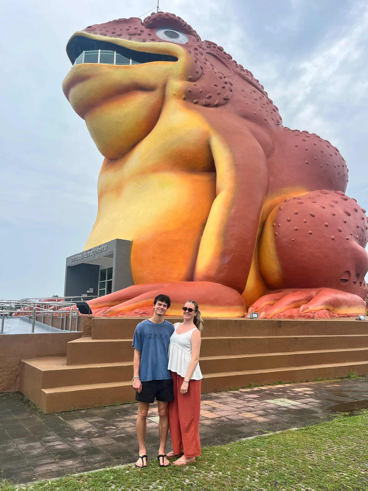
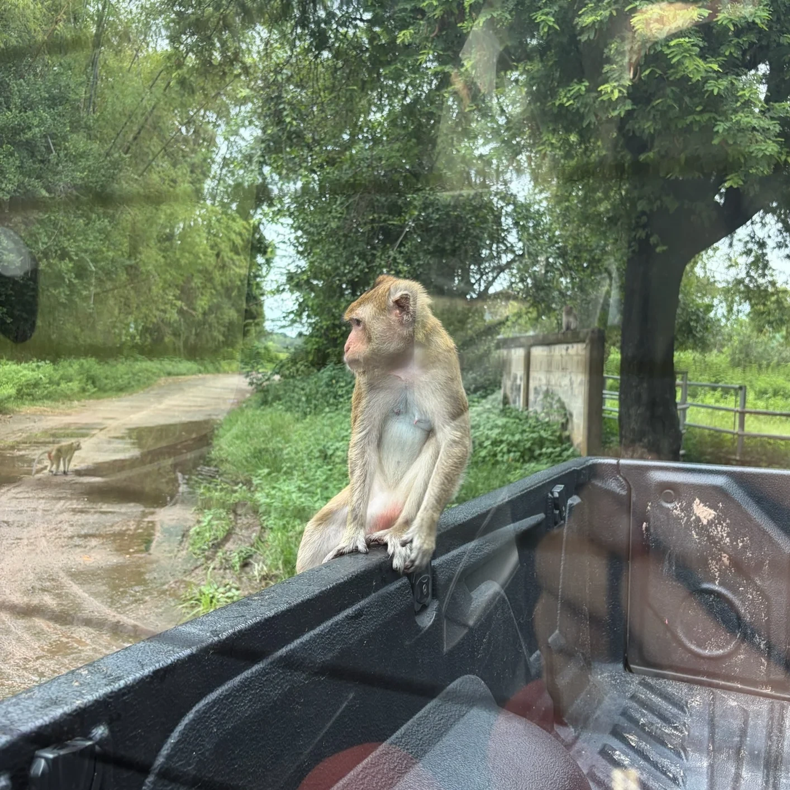
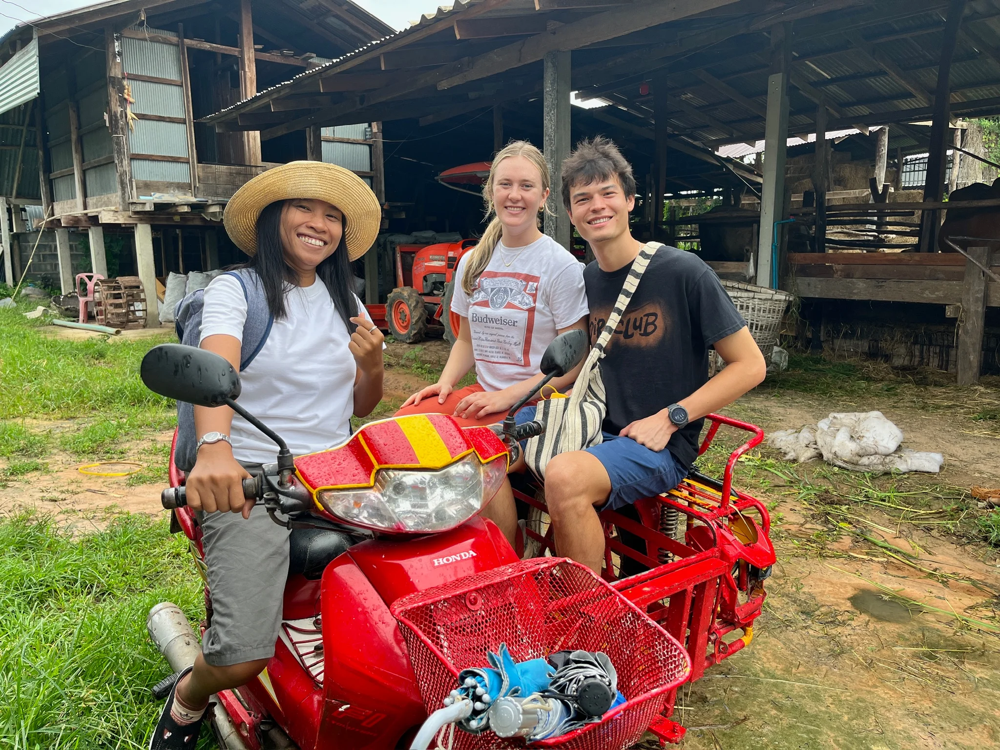

We spent the first week of our time in Thailand in Yaso, Tahn’s dad’s home village. It being less hot it was still a little bit rough sleeping on a mat on the floor, being constantly bit by mosquitos, and even seeing a (luckily dead) scorpion. Everyone gave me plentiful warning about how hot it would be but it rained the entire time, which I took as a win! 
One of Tahn’s relatives is a tour guide so we got the full Yaso experience which included seeing a giant toad statue, making popped rice decorations, and learning about the annual rocket festival, where villagers shoot up rockets and fireworks to tell the gods they’re ready for rain at the beginning of the growing season. 

The next day we got to see where all the monkeys live! There was so many of them and lots of babies. Tahn’s dad was an expert at feeding them and fending them off with a stick in order to not getting attacked.

Overall it was super cool to see where Tahn’s Thai side of his family is from and learn about the culture, food, and traditions of Northeast Thailand!

