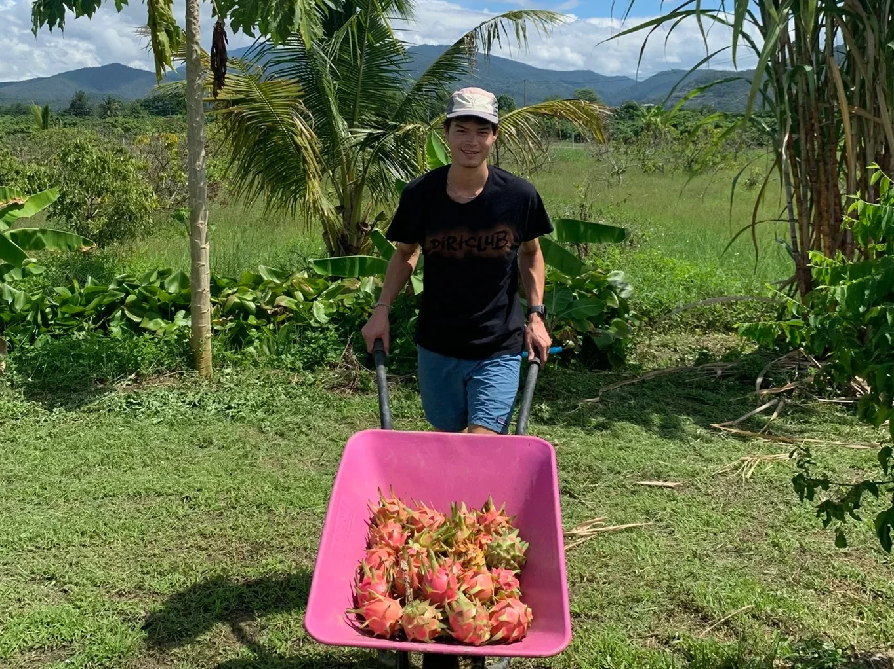
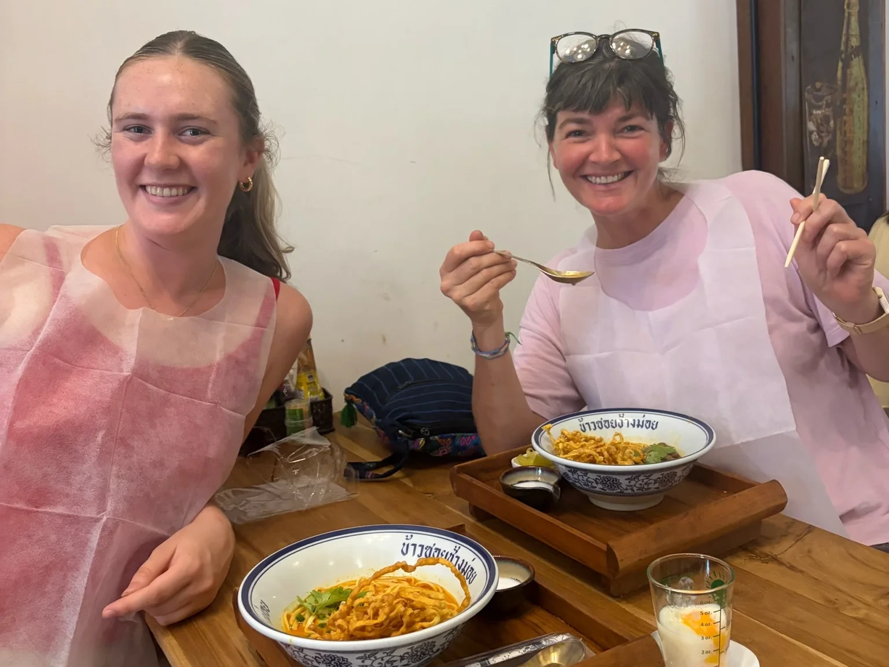
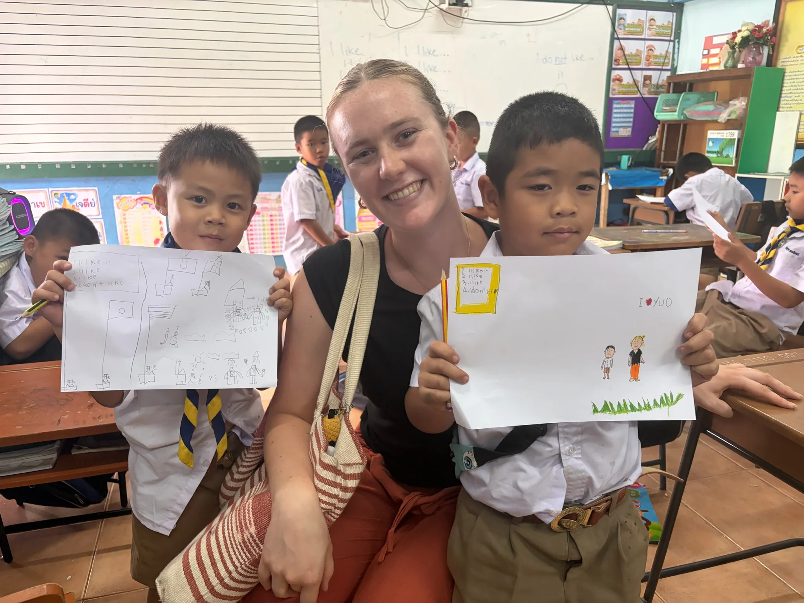

After getting back from Yeso, it was nice to settle into Peggy and Jo’s house in Cho Lae. They just built a new earthen house which we’ve gotten to help decorate and furnish. It’s been amazing to eat all the food they grow here on their land like dragon fruit, coconuts, green onion, dill, lemons, avocados, rice, and more! Many of our meals are made completely from the food they grow here. We have been spending lots of time going to coffee shops and the market on our bikes!  We have a favorite coffee shop, Kramfeine, which has great coffee and cakes. 

The city of Chiang Mai is also about an hour from their house so Tahn and I have been spending some weekends there. We have been to lots of amazing restaurants, including Tahn’s Aunt Yao’s new restaurant, Ma Dae Balance which was amazing! Another standout was Tacos Bell which was awesome because Mexican is hard to find! We also went to Warrarot market which has almost everything you could need and I got some linen pants. The university in Chiang Mai also has pick up sand volleyball so we have gone to that twice which was super fun and a great way to meet some new people! 

In Cho Lae I started volunteering at a school 2 days a week. I thought I was going assist the teacher in handing out papers or reading stories, but when I arrived the teachers left and I taught the lesson by myself! Although that was a little scary at first I ended up enjoying having total freedom on what to plan and teach each week. All of the kids were super excited I was there and since they didn’t know much English they would usually just clap when I arrived, giving me a pretty grand entrance each day.

