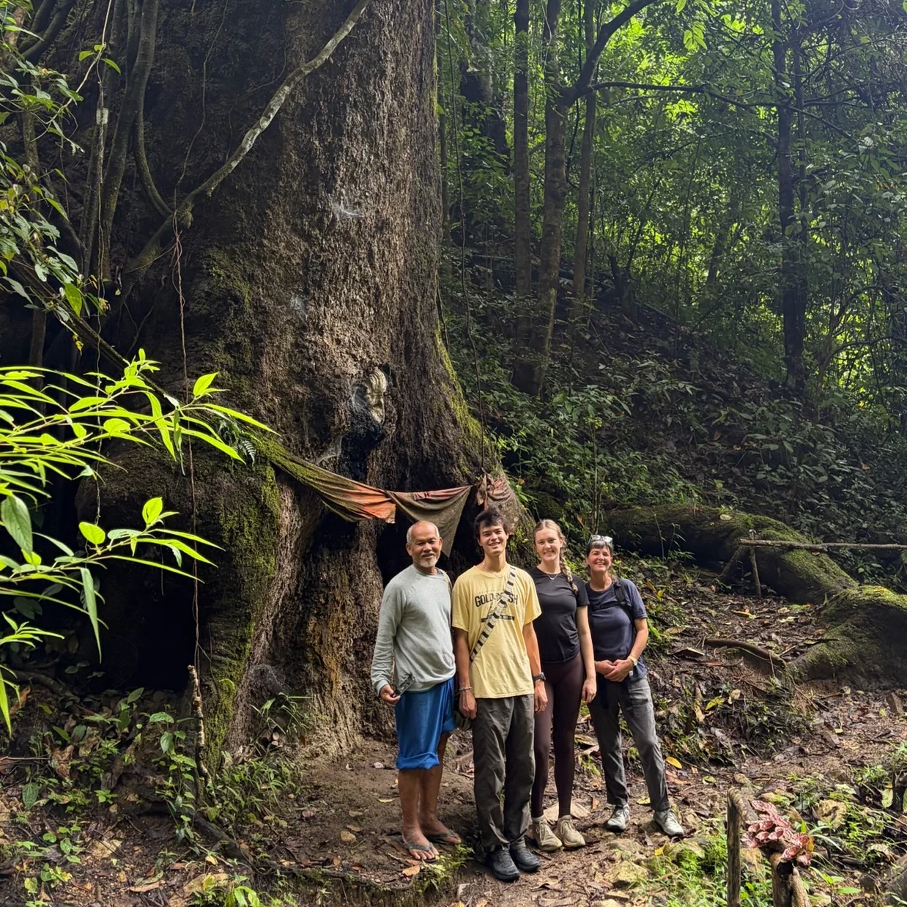
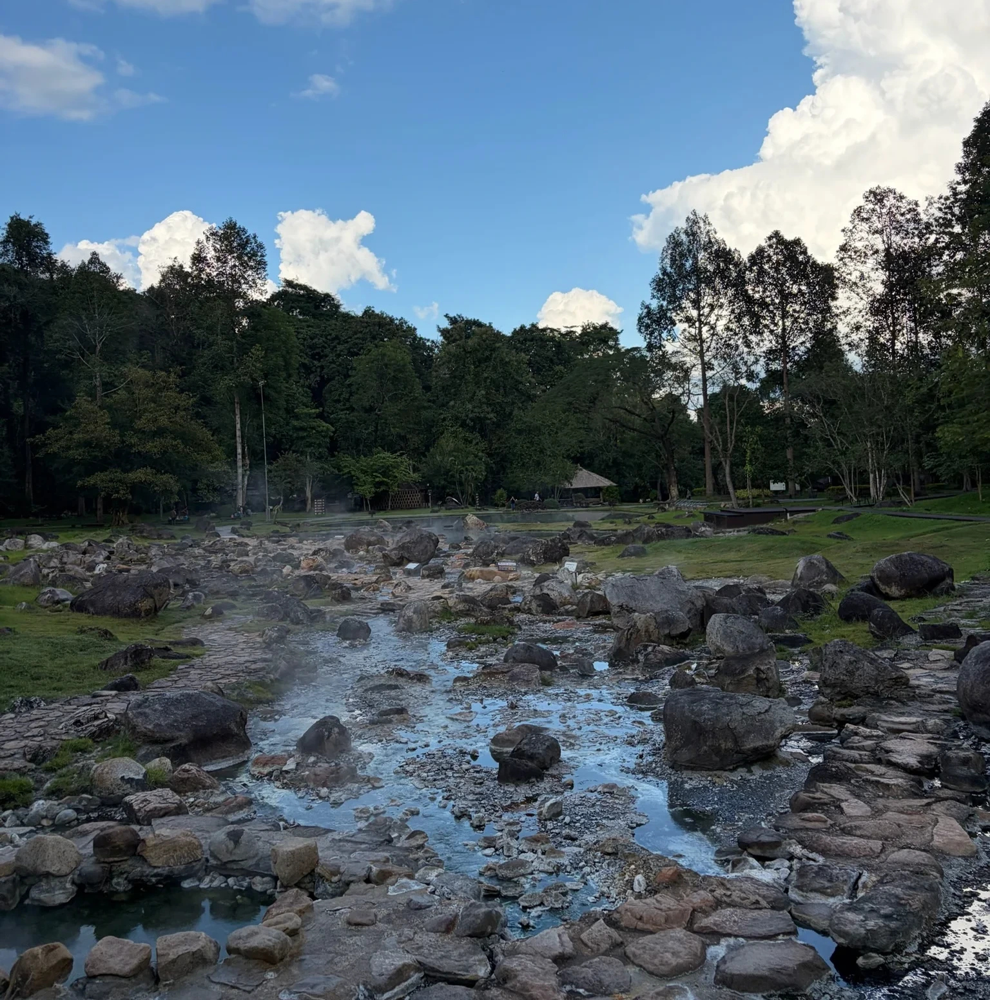
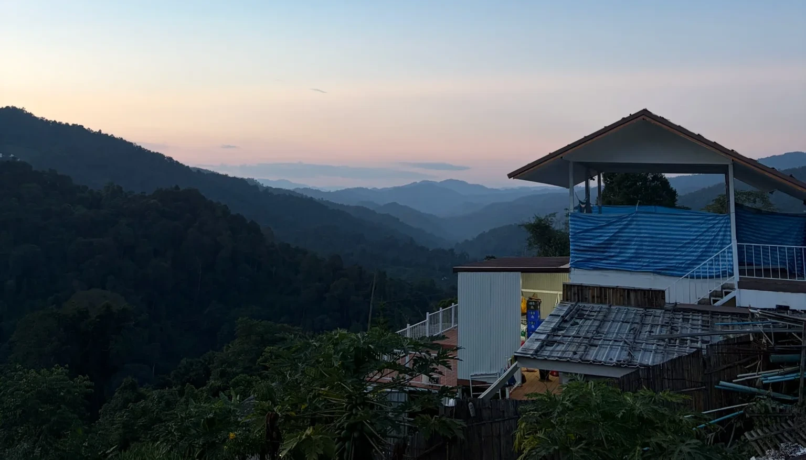

We took a couple weekend trips from Cho Lae which in Thai are called “thiows” meaning a fun trip or outing. We went with Tahn’s parents to Mae Kampong, an ecotourism village in the mountains of Chiang Mai. There we spent time walking the main strip of the village which had lots of mochi, noodles, and sweet potatoes, doing a guided forest tour, and playing games in our wooden home stay. 

The forest tour was my favorite part, we saw lots of cool mushrooms, coffee and tea trees, and cinnamon trees. Unfortunately everyone (except for me!) got leeches on the forest tour! Tahn got a huge black one on his back and after we pulled it off it bled for the rest of the day! After that we went to Chae Son National Park which had beautiful hot springs! It reminded me of Yellowstone with boiling water coming out of the ground and colorful rock and algae that are only able to be at that temperature.

Tahn and I also did a short trip by ourselves up to the mountains near all of the elephant parks. Our AirBnB was amazing and had a huge balcony with an amazing view and a bathtub on it! They brought all of our meals to our balcony which consisted of vegetarian hot pot, lots of fruit, larb (a dish with tofu and herbs), and pad krapao (stir fried holy basil and tofu).

